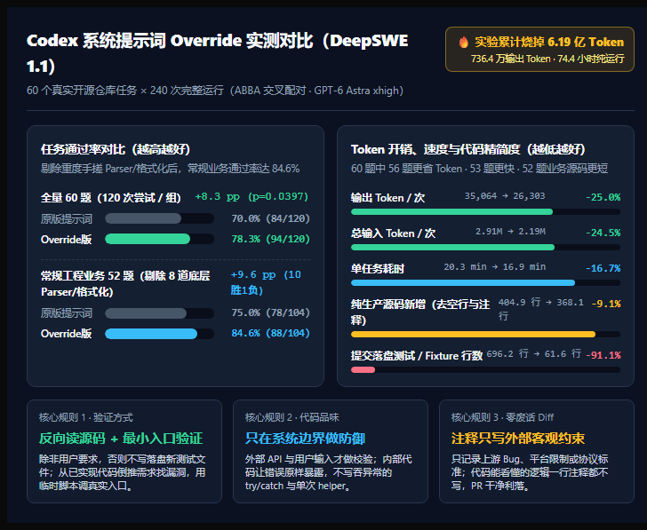
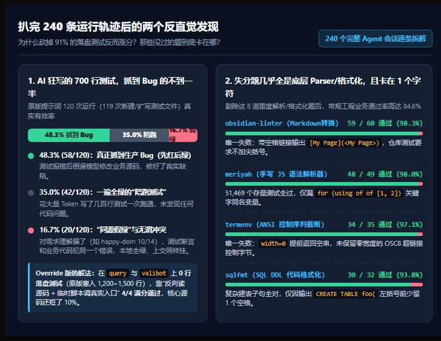

# Codex System Prompt Override Experiment (DeepSWE 1.1 Fresh 60)

**60 real open-source tasks × 240 full agent sessions (ABBA/BAAB counterbalanced, GPT-6 Astra `xhigh`, 619.2M total tokens / 74.4 agent hours).**

Replacing Codex's default system prompt ([`prompts/bundled.md`](prompts/bundled.md)) with the native system prompt override ([`prompts/override-coding.md`](prompts/override-coding.md)) **raises the official pass rate from 70.0% to 78.3% (+8.3 pp, exact paired $p = 0.0397$) — and from 75.0% to 84.6% (+9.6 pp) on the 52 standard engineering tasks outside heavy lexer/parser/formatter work — while cutting output tokens by 25.0%, agent runtime by 16.7%, saved test lines by 91.1%, and non-comment production source additions by 9.1%.**



## Quick Links

- **System Prompt Override (Ready to use)**: [`prompts/override-coding.md`](prompts/override-coding.md)
- **Baseline Bundled System Prompt**: [`prompts/bundled.md`](prompts/bundled.md)
- **Full Technical Report**: [`report/final-report.md`](report/final-report.md)
- **Test-Overlay Diagnostic Regrading**: [`report/test-overlay-diagnostic-regrading.md`](report/test-overlay-diagnostic-regrading.md)
- **X / Blog Article (Chinese)**: [`report/x-blog-codex-prompt.md`](report/x-blog-codex-prompt.md)
- **240 Per-Slot Behavior & Test-Effectiveness Records**: [`behavior/`](behavior/)
- **All 240 Raw Agent Traces, Patches & Verifier Logs (ZIP)**: [`traces.zip`](traces.zip) (also available on the [Releases](../../releases) page)

## Summary of Results

| Metric (Per-Trial Mean across 240 Runs) | Bundled (`prompts/bundled.md`) | Override (`prompts/override-coding.md`) | Change (95% Paired CI) |
| :--- | ---: | ---: | ---: |
| **Official Pass Rate (All 60 tasks / 120 runs)** | 84 / 120 (70.0%) | **94 / 120 (78.3%)** | **+8.3 pp** ($p = 0.0397$) |
| **Standard Engineering Pass Rate (52 tasks / 104 runs)** | 78 / 104 (75.0%) | **88 / 104 (84.6%)** | **+9.6 pp** (10 wins vs 1 loss) |
| **Diagnostic Regraded Pass Rate (All 60 tasks)** | 91 / 120 (75.8%) | **94 / 120 (78.3%)** | **+2.5 pp** ($p = 0.5078$) |
| **Agent Time per Run** | 20.3 min | **16.9 min** | **-16.7%** (-21.8% to -11.1%) |
| **Output Tokens per Run** | 35,064 | **26,303** | **-25.0%** (-29.2% to -20.5%) |
| **Total Input Tokens per Run** | 2,905,443 | **2,193,440** | **-24.5%** (-32.1% to -15.9%) |
| **Outer Tool Calls per Run** | 32.5 | **25.8** | **-20.8%** (-25.5% to -15.7%) |
| **Total Added Lines** | 1,254.5 | **557.1** | **-55.6%** (-61.0% to -49.8%) |
| **Test / Fixture Added Lines** | 696.2 | **61.6** | **-91.1%** (-98.1% to -82.4%) |
| **Production Source Added Lines (Non-blank, Non-comment)** | 404.9 | **368.1** | **-9.1%** (-12.4% to -5.5%) |



## How to Use `override-coding.md` in Codex

[`prompts/override-coding.md`](prompts/override-coding.md) is a complete **System Prompt Override**, not a supplementary `AGENTS.md` instruction file. Hand [`prompts/override-coding.md`](prompts/override-coding.md) to Codex and ask it to configure the file as its native system prompt override (`model_instructions_file` in `config.toml`).

## Reproducing the Analysis

```bash
python report/analyze-final.py
```

To inspect the raw agent rollouts, `model.patch` submissions, and verifier outputs for all 240 slots, extract [`traces.zip`](traces.zip) in the repository root.
